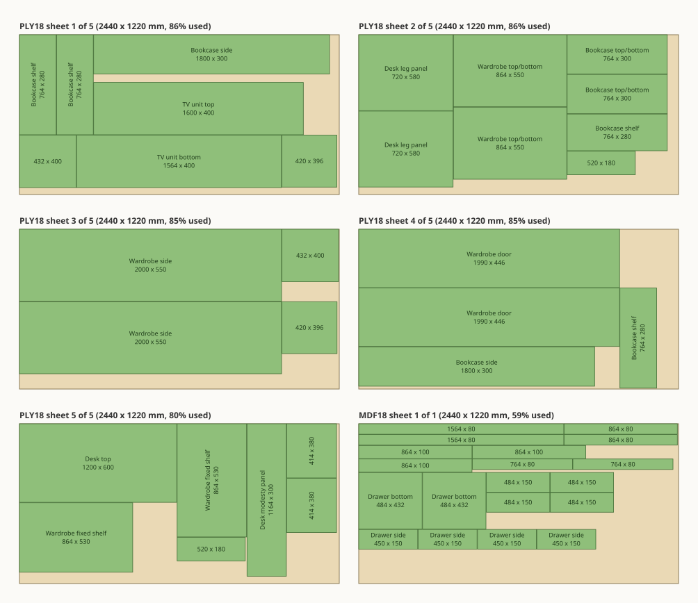

<a href="https://siluvo.com/grainline?utm_source=github&utm_medium=readme&utm_campaign=grainline-layout">
  <picture>
    <source media="(prefers-color-scheme: dark)" srcset="docs/brand/siluvo-logo-horizontal-birch.svg">
    
  </picture>
</a>

# Siluvo Grainline Layout

Siluvo Grainline turns a woodworking cut list into sheet layouts you can cut:
which part goes on which sheet of plywood or MDF, with grain direction respected,
and the order of saw cuts that releases every part. This repository is the layout
engine behind the Grainline web app at [Siluvo](https://siluvo.com/grainline?utm_source=github&utm_medium=readme&utm_campaign=grainline-layout), as a
dependency-free Python package and command-line tool.

[](https://siluvo.com/grainline?utm_source=github&utm_medium=readme&utm_campaign=grainline-layout)

*`examples/cabinet-set-49.json`: a wardrobe, bookcase, TV unit and desk, 49 parts.
Five sheets of plywood, which is the fewest the part area allows, plus one of MDF,
with 79 saw cuts in a checked order. Drawn by `tools/render_svg.py`.*

## Is this worth your time?

If you searched for a cut-list or sheet-nesting solver, you are probably choosing
between a few projects and writing one yourself. We compared before publishing,
so you can decide from numbers.

**What we compared against**, on the 17 furniture cases in
[`benchmarks/`](benchmarks/README.md), with the same kerf, trim and grain rules:

- [PackingSolver](https://github.com/fontanf/packingsolver), the strongest
  open-source solver we know of for guillotine cutting. It is a C++ research
  solver and it also proves lower bounds.
- A genetic algorithm over part order and a greedy guillotine packer, the two
  approaches most small cut optimizers use, as implemented in
  [CutStock](https://github.com/orohde/CutStock).

| 17 cases, 555 parts, 21 materials | Sheets used |
|---|---:|
| Proven minimum possible (PackingSolver's bound) | at least 65 |
| PackingSolver, 10 s per material | 70 |
| **Grainline**, default preset | **70** |
| Genetic algorithm (CutStock GA) | 73 |
| Greedy guillotine (CutStock nested) | 78 |

What that table does and does not show:

- **Sheet count.** Grainline matches PackingSolver on all 21 materials. 17 of them
  are proven optimal; on the other 4 neither solver found better or proved a bound.
- **We tuned on these cases.** Before this comparison Grainline used one sheet more
  than PackingSolver on two of them. The comparison is why a pattern search was
  added, and both now match. Matching cases you have fixed against is weaker
  evidence than matching unseen ones, so expect PackingSolver to win now and then
  on your own jobs.
- **Speed.** PackingSolver is faster: it solved 17 of the 21 materials in under a
  second each, with proof. Grainline takes 1 to 2 seconds for a typical job and up
  to 7 seconds here. A greedy packer takes milliseconds.
- **Offcuts.** We measured the largest rectangular offcut left when sheet counts
  are equal. Grainline's was larger than PackingSolver's on 8 materials and
  smaller on 7. We do not claim better offcuts.

**If all you need is the fewest sheets, fast, and you can run a C++ binary, use
PackingSolver.** It is the better packer.

A coding model can also write a random-search packer in one sitting, and for a
single sheet count that is a fair alternative. One did find the five-sheet answer
above before Grainline did, with a two-minute budget, and Grainline's fixed-sheet
search was added because of it.

**What this package is for** is the step after packing, in something you can
`pip install`:

- **A cutting sequence, checked.** Each sheet comes with ordered through-cuts.
  Before a result is returned, the sequence is replayed cut by cut: every cut must
  act on a workpiece that exists, miss every finished part, and leave every part
  separated at the end. A layout that fails is rejected, not returned with a warning.
- **Woodworking input.** You say which way the sheet's grain runs and whether each
  part's length or width must follow it, and give finished sizes for edge-banded
  parts. A general solver can respect the same constraints, but you have to turn
  them into fixed orientations and cut sizes yourself.
- **Saw-friendly layouts.** Every sheet is guillotine-cuttable, so it can be broken
  down with a track saw, table saw or panel saw using edge-to-edge cuts, with the
  blade width kept between parts.
- **An independent validator.** `grainline validate` checks any result against its
  problem, so you do not have to trust the solver's own report.
- **Reproducible runs.** The default budget is a fixed number of trials, not a time
  limit, so the same input gives the same layout.
- **Nothing to set up.** Pure Python 3.10+ standard library: no compiler, binary,
  account, database or network access. Apache-2.0.

## The web app does the rest

This package stops at layout and cutting data in JSON. If the goal is to stand at
a sheet of plywood and cut, the [Grainline web app](https://siluvo.com/grainline?utm_source=github&utm_medium=readme&utm_campaign=grainline-layout) is the same family of
engine with the parts that make a plan usable in the shop:

[](https://siluvo.com/grainline?utm_source=github&utm_medium=readme&utm_campaign=grainline-layout)

- **Dimensioned layouts.** Click a part to see its size, its distance from the
  sheet edges and the kerf around it, with the numbers placed so they stay readable.
- **PDF export for the shop.** Print the plan and take it to the saw. Export is
  free and has no watermark.
- **Cut-flow animation.** Watch a sheet broken down step by step, or pick one part
  and see how it is released.
- **Finished-size edge banding.** Mark the banded edges; cut sizes and the banding
  you need to buy are worked out for you.
- **Parts in, without retyping.** Paste rows or import CSV or XLSX, with a preview
  that catches wrong boards and thickness mismatches. Metric and imperial.

It runs in the browser and can be tried without an account.

## Install

```sh
python -m pip install git+https://github.com/siluvo/grainline-layout
grainline --version
```

From a checkout, use `pip install .` (or `pip install -e .` for development).
Packaging needs setuptools; runtime has no third-party dependencies. The Python
distribution is named `grainline-core` and the import name is `grainline`.

## CLI

```sh
grainline optimize examples/cabinet-set-49.json -o result.json
grainline optimize examples/cabinet-set-49.json --preset thorough --random-seed 42 -o thorough.json
grainline optimize examples/cabinet-set-49.json --partition-tries 0 -o frontier-only.json
grainline optimize examples/cabinet-set-49.json --partition-tries 12000 --partition-plans 6 -o custom.json
grainline optimize examples/cabinet-set-49.json --time-limit 10 -o bounded.json
grainline validate examples/cabinet-set-49.json result.json
```

`python -m grainline` is equivalent to the console script. `-` selects stdin or
stdout. JSON output is UTF-8; diagnostics go to stderr. An output file is replaced
atomically, and cannot be the input file. Exit codes: **0** complete / validation
passed; **2** invalid input or I/O error; **3** incomplete / validation failed;
**4** internal solver validity failure. An incomplete solve still writes its result.

## Python

```python
import json
from grainline import SearchOptions, optimize, validate

with open("examples/cabinet-set-49.json", encoding="utf-8") as stream:
    problem = json.load(stream)

options = SearchOptions.from_preset("balanced", partition_tries=12000, random_seed=42)
result = optimize(problem, options=options)
assert not validate(problem, result)
print(result["status"], result["sheets_used"], result["search"])
```

Passing `options=` replaces all embedded options. Without it, `problem.options`
may contain `preset` and any SearchOptions field. In the CLI, explicit flags override
the corresponding embedded options; presets fill defaults, then individual values
override them. Unknown search options are rejected.

## Search budgets, not different algorithms

All presets use the same adaptive-frontier engine plus optional fixed-sheet
partition search. They are **not** a greedy / genetic algorithm switch.

| Setting / CLI flag | fast | balanced (default) | thorough |
|---|---:|---:|---:|
| `seed_limit` / `--seed-limit` | 2 | 5 | 10 |
| `candidate_pool_limit` / `--candidate-pool-limit` | 8 | 18 | 36 |
| `partition_tries` / `--partition-tries` | 500 | 6000 | 24000 |
| `partition_plans` / `--partition-plans` | 1 | 3 | 8 |
| `seed_early_stop` / `--[no-]seed-early-stop` | true | true | false |

- **Starting layouts:** `seed_limit` is the number of candidate starting *pieces*,
  not the random seed or exact number of layouts. An automatic start plus allowed
  orientations can create more trials. Duplicate layouts can end this search early.
- **Candidate pool:** limits which pieces compete during placement. Minimum 8.
- **Partition trials:** randomized search for how to divide parts across a smaller
  fixed number of sheets. Maximum trials **per target sheet count per material**;
  stops earlier when enough distinct plans are found. Set 0 to disable this fallback.
  When those trials find nothing, a second search with about the same budget samples
  single-sheet patterns and looks for a set of them that holds every part.
- **Partition plans:** maximum distinct splits considered per target. The first
  valid plan reaching that target is accepted; the budget is a cap, not required work.
- **Random seed:** `random_seed` / `--random-seed` defaults to 20261011, affects only
  randomized partition search. The deterministic frontier search does not use it.
- **Sheet cap:** `max_sheets` / `--max-sheets` defaults to 100 **per material group**.
- **Time caps:** `time_limit` / `--time-limit` is a soft total solve budget;
  `partition_time_limit` / `--partition-time-limit` is a soft fallback budget per
  material. Both default to `None`. Existing atomic layout / cleanup / validation
  work can overrun a cap. Each material gets at least one attempt so the result
  accounts for every part, even when the budget has expired. This is not a hard
  process timeout. Results may be incomplete; inspect `status` and `search`.

The default uses fixed trials, no wall-clock stopping. Identical ordered inputs,
options and package versions are intended to reproduce placements/cutting data
on the same Python/runtime; timing telemetry naturally differs. Time-limited runs
depend on machine load. Larger budgets and `thorough` can choose different search
paths and **do not guarantee fewer sheets or a globally optimal result**. The
current partition fallback skips targets requiring over 93% utilization. Neither
budget exhaustion nor failure to find a layout proves infeasibility.

For fair comparisons, publish the full options, version, input hash, hardware,
elapsed time, validity, sheet count **per material**, utilization and cutting-plan
availability. Compare fixed-budget runs separately from time-limited runs. Actual
seed trials and partition target statistics are included in `telemetry`.

## Input contract (schema version 1)

```json
{
  "units": "mm",
  "kerf_mm": 3,
  "boards": [
    {"code": "PLY18", "length_mm": 2440, "width_mm": 1220,
     "thickness_mm": 18, "grain_axis": "long",
     "trim_mm": {"left": 0, "right": 0, "top": 0, "bottom": 0}}
  ],
  "parts": [
    {"id": "side", "name": "Cabinet side", "board": "PLY18",
     "length_mm": 1800, "width_mm": 550, "quantity": 2,
     "grain_direction": "length"}
  ],
  "options": {"preset": "balanced", "random_seed": 42}
}
```

- Units are millimetres only. Dimensions must be finite and positive; kerf and
  trims may be zero. Up to 500 expanded parts per solve. Quantity is a positive integer.
- Boards are unlimited identical stock within each material's sheet cap; finite
  inventory and substitution between board codes are not supported.
- `grain_axis`: `long`, `short`, `none`, relative to the board's geometric edges.
  Part `grain_direction`: `length`, `width`, `any`. Rotation follows these constraints.
  Legacy direction aliases (including `long`, `short`, `none` and null) are normalized;
  unrecognized directions are rejected rather than silently dropping the constraint.
- `code` identifies a board/material group; `board` on each part must reference it.
  Optional part IDs must be unique and contain no `:`; defaults are `p0`, `p1`, ... .
- Optional `cut_length_mm` and `cut_width_mm` must be supplied together and must
  not exceed finished dimensions. These are the dimensions physically laid out,
  after edge-band deductions. The API does not resolve a material database.
- `name`, `id`, `title`, `category`, `why` and other descriptive case metadata do
  not affect layout. Canonical operational field names above are required.

## Result contract

Top-level `status`, `sheets_used`, `unplaced_count`, `validation`, `search`, and
`boards` summarize the run. Each board group has `board_id`, `required_sheets`,
`usable_length_mm`, `usable_width_mm` and `layouts`. Layouts include `placements`,
`leftovers`, `cut_plan_steps`, `cut_plan_modes` and diagnostics. Coordinates use
the usable area's local origin (board trim is excluded): x along input board length,
y along input board width. Placement IDs include an occurrence suffix.

`complete` means all requested parts were placed in geometrically validated,
guillotine-cuttable layouts. It does **not** mean optimal or machine-ready.
Default cut sequences are replay-validated: each cut consumes a live workpiece,
preserves finished parts, and ends with every part isolated. Edge trimming can
legitimately leave one surviving workpiece. An exact stock-sized part requires
zero cuts; `cut_plan_meta.validation.cut_required` reports that case explicitly.
Missing or incomplete required sequences are rejected, not accepted with a warning.
The independent validator checks multiplicity, material, dimensions, rotation/grain,
sheet bounds, kerf separation, recursive guillotine geometry and the default
through-cut replay. It does not certify machine operations or cutting safety. Treat diagnostic details as
unstable while the package is at version 0.1.

## Development checks

```sh
python -m unittest discover -s tests -v
python tools/check_cases.py benchmarks/cases --baseline benchmarks/baseline.json
```

`tools/check_cases.py` solves every case, validates the result and fails when a
material needs more sheets than the recorded baseline. See `PROVENANCE.md` for how
this package relates to the engine running on the website.

## Name and license

Code is licensed under Apache-2.0. "Siluvo" and "Grainline" are names used by
Siluvo LLC for this software and are not licensed as trademarks; see `NOTICE`.
The Siluvo logo files in `docs/brand/` are not covered by the Apache license.
Other products named Grainline exist in other fields and are unrelated.
